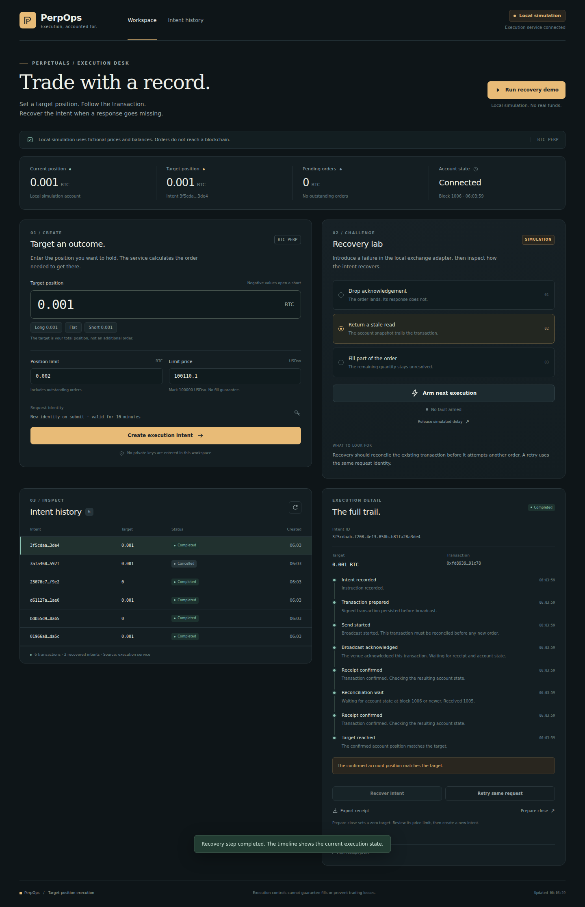

# PerpOps

Recover interrupted DreamDEX trades before attempting another order.

PerpOps is a local target-position executor and recovery workbench for bot builders
and traders who need to know what happened after a timeout or process crash.



Set a desired BTC position, a quantity limit, an execution price limit and a
deadline. PerpOps records the instruction, persists its signed transaction before
broadcast, then checks the receipt and resulting account state. Replaying the
same instruction resumes its existing record.

This standalone repository includes a durable local exchange simulator and a
DreamDEX Hideki adapter. The interface labels those modes explicitly. Simulation
receipts are not on-chain evidence.

Start with the [demo guide](docs/demo-script.md), [verification](docs/verification.md),
and [submission package](docs/submission.md).

## Bounty feedback and demo

Two independently reproduced reports accompany the application:

- [Close helper retains an older quantity after the position shrinks](feedback/001-close-position-stale-quantity.md).
  The offline harness invokes unchanged official bot-kit functions and checks
  seven controlled scenarios.
- [Documented USDso bridge quote reverts](feedback/002-usdso-bridge-quote.md).
  A read-only RPC reproduction compares five routes at the same canonical block.

After installing dependencies with `npm ci`:

```bash
npm run feedback:close
npm run feedback:bridge
```

The reports are prepared for the Feedback track. No report is claimed accepted
or first. The MVP's actual testnet opening and closing orders remain pending
initial funding. [Funding observations and next steps](docs/funding.md) explain
the available route and the remaining faucet access requirement.

[Watch the 100-second captioned local demonstration](docs/demo.mp4).

## Run the workbench

Requires Node.js 24 or later.

```bash
git clone https://github.com/Whyme-Labs/perpops.git
cd perpops
npm ci
npm start
```

Open http://127.0.0.1:4317. The default mode is **Local simulation**. No wallet,
API key or funds are needed. The simulated BTC price is a fixed fixture at
100,000 USDso and is not current market data.

Click **Run recovery demo**. The simulated exchange fills an order, commits it to
its own database, then deliberately drops the response. The instruction becomes
uncertain. Click **Recover** to reconcile the original transaction and confirm
the target. Export its receipt to inspect the entire event sequence.

The fault lab also supports a connection failure before the exchange receives the
transaction, a stale post-transaction account read, partial IOC fill and delayed
receipt. **Resend saved transaction** first checks for an existing receipt, then
resends the exact saved bytes only when trading is enabled, the deadline remains
open and the account still matches its pre-trade state. It never creates a new
nonce or replacement order. **Release simulated delay** restores the withheld
information. A partial fill requires an explicit resume before another attempt.

To close a position, use **Prepare close**, review the zero target and price
limit, then submit a new instruction. Cancelling an instruction only stops future
work. It does not flatten the account or cancel a transaction already sent.

## Reproduce recovery from the command line

```bash
npm run demo
npm run check
```

The demo persists a simulated filled transaction, closes both databases, reopens
them and replays the original instruction. The output reports one prepared
transaction, one broadcast and one execution with the same transaction identity.

The tests go further. They terminate real child processes with SIGKILL both
before broadcast and after the simulated exchange commits a fill. Recovery uses
the original signed bytes. Other tests cover writer exclusion, concurrent
replays, receipt errors, partial fills, stale reads, price/quantity precision,
deadline expiry and account drift. The HTTP test opens a loopback port.

The browser smoke test exercises the real simulation server on desktop and mobile:

```bash
npx playwright install chromium
npm run test:browser
```

If Chromium is already installed elsewhere, set `PERPOPS_CHROMIUM` to its absolute
executable path. The script uses a temporary simulation database and prints the
locations of its screenshots and report. `docs/browser-verification.json` records
the verified flows, and `docs/workbench.png` shows the interface.

## Check the actual DreamDEX testnet

```bash
npm run doctor
```

This command only reads the live RPC. It verifies chain ID 50383, discovers the
BTC pool, verifies its margin bank and collateral, reads token precision, checks
the mark and book, and reads the account at a pinned block. It also reports gas
and margin balances. With no account configured it reads the zero address.

If your runtime uses an HTTP proxy, Node 24 can respect its proxy environment:

```bash
NODE_USE_ENV_PROXY=1 npm run doctor
```

`docs/testnet-readiness.json` records a successful read-only check. It contains no
trade receipt. `docs/recovery-demo.json` is explicitly local simulation evidence.

## Use a dedicated testnet account

```bash
npm run wallet:create
```

This creates a disposable key in `.env.testnet` with file mode 0600, refuses to
overwrite an existing file and prints only the public address. This file is
ignored by git. Fund the address on **Hideki, chain 50383**, with test STT for gas
and USDso margin. A balance on Shannon chain 50312 does not fund this account.

For this adapter, ask the organizer's official support flow to fund the dedicated
EOA with Hideki gas and usable USDso margin or perp credit. The app's Arena funds
belong to its app trading wallets. Linking a bot does not move that margin into
the bot's EOA, and this milestone does not implement operator `placeOrderFor`.
The voucher and account eligibility rules must be checked for your account. Do
not assume a fresh EOA can claim paper margin successfully. No faucet automation
or funding transaction is included in this milestone.

Copy the generated config to `.env` and set `PERPOPS_TESTNET_TRADING=1` when the
dedicated test account is ready. Then run the doctor and start the workbench.

```dotenv
PERPOPS_MODE=dreamdex
PERPOPS_ACCOUNT=0x_your_disposable_account
PERPOPS_PRIVATE_KEY=0x_your_disposable_key
PERPOPS_TESTNET_TRADING=1
```

The key stays on the local server. There is no browser field for private keys.
The adapter refuses other chain IDs. It does not support mainnet, linked operator
wallets, account abstraction or multiple markets. The prototype caps an
instruction's configured position limit at 0.01 BTC.

Keep the existing journal and its exchange/account binding. Changing mode,
account, pool or precision requires a different data directory. Default storage
is `.data/simulation` or `.data/dreamdex`.

## Execution model

1. Validate decimal strings and convert them to integer market units.
2. Bind the journal to one account, market, network and precision.
3. Persist the instruction ID and its canonical request fingerprint.
4. Read position and pending orders at one block.
5. Check independent pending-buy and pending-sell exposure, lot size, price limit
   and deadline. Resting orders outside this IOC executor block new trading.
6. Prepare and sign locally. Persist signed bytes, hash and nonce before I/O.
7. Re-read the account before sending. Position drift pauses the prepared action.
8. Commit a send-start event before broadcasting the saved transaction.
9. Reconcile a canonical receipt and account state at or after its block.
10. Complete the target, report a partial fill, or hold unresolved work.

The DreamDEX adapter currently waits for at least two block confirmations. This
is a configurable confirmation threshold, not a mathematical finality guarantee.
A missing receipt never proves that a transaction did not execute. Unknown
outcomes stay active even after the instruction deadline and prevent new
instructions. The application does not discard or automatically replace them.

If the process dies after recording send-start but before the transaction reaches
the RPC, **Recover** keeps reconciling the original hash. The explicit **Resend
saved transaction** action can resend its original envelope before the signed
order deadline. It rechecks the account and stops if state changed. After the
deadline, an unknown transaction remains unresolved for investigation. Nonce
replacement, fee bumps and automatic expiry-based abandonment are not supported.

For current position `q`, pending buys `b` and pending sells `s`, possible fills
produce the interval `[q - s, q + b]`. Opposing orders are not netted. The bound
assumes only those orders change the account. It is not a loss guarantee.

## Limitations that matter

- One dedicated account and one execution writer are required. Other wallets,
  manual trades, liquidations and external transactions can change exposure.
- The verified SDK 0.32.1 ordinary IOC ABI has **no native reduce-only flag**.
  Testnet closes therefore use a quantity-limited IOC under the dedicated-account
  assumption. The UI exposes this capability. The simulator supports native
  reduce-only behavior for comparison. It must not be mistaken for the live ABI.
- The final read and transaction inclusion are separate events. An account can
  change in that interval. There is no unconditional no-overshoot or exactly-once
  guarantee for exchange effects.
- A price limit restricts that order's fill price. It does not guarantee a fill,
  maximum loss, margin health or a successful emergency exit.
- The current model reconciles net position. It does not produce complete P&L,
  funding attribution or order-level fill attribution for multiple actors.
- Wallet keys and signed bytes require local disk protection. Exported receipts
  omit both. Restoring an old database while trading can break recovery history.
- The SQLite lock assumes one local filesystem without hard-link aliases. Do not
  put the journal on a shared network filesystem or run separate journal copies
  against the same account.
- The web server binds to loopback and rejects foreign Host/Origin headers. It has
  no remote-user authentication. Do not expose it publicly through a tunnel.

## API and CLI

`GET /api/state` returns the current account, instructions and journal timelines.
`POST /api/intents` accepts an instruction. Reusing its ID with different contents
returns a conflict. Use a new ID for a new target.

```json
{
  "id": "my-btc-instruction-001",
  "target": "0.001",
  "maxPosition": "0.002",
  "limitPrice": "100100",
  "deadline": "REPLACE_WITH_A_FUTURE_ISO_TIMESTAMP"
}
```

Other routes are `POST /api/intents/:id/resume`,
`POST /api/intents/:id/rebroadcast`, `POST /api/intents/:id/cancel`,
`GET /api/intents/:id/receipt`, and `POST /api/recover`. All POST requests require
JSON and the header `X-PerpOps-Client: workbench`. Fault controls exist only in
simulation mode.

The CLI supports `execute instruction.json`, `resume INTENT_ID`,
`rebroadcast INTENT_ID`, and `receipt INTENT_ID`. Start it with
`node --env-file-if-exists=.env src/cli.ts`. Stop the web server first because both
use the same exclusive writer lock.

## Sources

- [DreamDEX perps developer guide](https://app.dreamdex.io/docs/developers/perps-testnet)
- [Official DreamDEX bot kit](https://github.com/somnia-chain/dreamdex-bot-kit)
- [Perps orders](https://app.dreamdex.io/docs/trading/perps-testnet/orders)
- [Bot permission limits](https://app.dreamdex.io/docs/trading/common/link-a-bot)

The executable scope is recorded in [the milestone](docs/milestone.md).
Submission materials report measured behavior and separate local simulation,
read-only chain observations, and genuine transaction receipts.

## X posts

Drafts are in [docs/social-posts.md](docs/social-posts.md). No posts have been
published and there are no fabricated post URLs. Add the actual links here after
publishing the required MVP updates.
